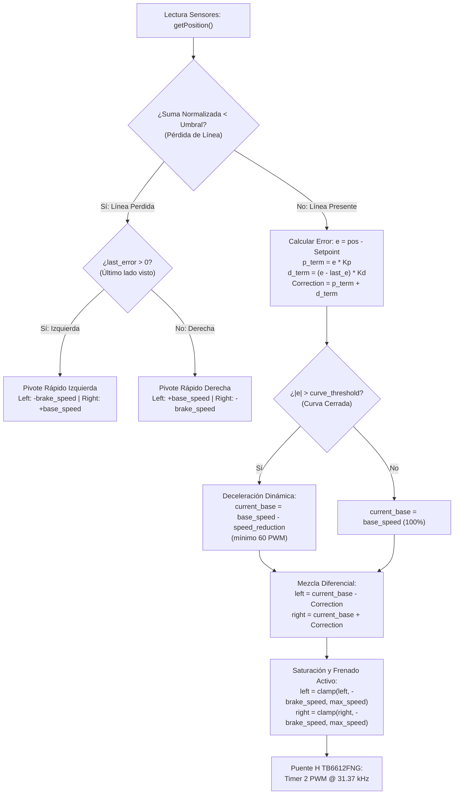

# Compendio Matemático y Físico del Seguidor de Línea
## Guía de Calibración, Modelado Dinámico y Cálculo de Límites de $K_p$ y $K_d$

> **Proyecto:** Seguidor de Línea de Alta Velocidad (16 Canales Multiplexado / 8 Canales Analógico Directo)  
> **Microcontrolador:** ATmega328P (Arduino Nano @ 16 MHz)  
> **Driver de Potencia:** Puente H TB6612FNG (PWM @ 31.37 kHz por Hardware - Timer 2)

---

## 1. Arquitectura Sensorial y Cálculo de Posición

El robot determina la posición transversal de la línea utilizando un arreglo frontal de fototransistores infrarrojos mediante el algoritmo de **Centro de Masa Ponderado (Centroid / Sub-Sensor Interpolation)**.

### 1.1. Constantes Sensoriales por Categoría

| Parámetro | Categoría 16 Líneas (`IM_16`) | Categoría 8 Líneas (`CODEX_8`) | Significado Físico |
| :--- | :---: | :---: | :--- |
| **Número de Sensores ($N$)** | $16$ ($S_0 \dots S_{15}$) | $8$ ($S_0 \dots S_7$) | Número total de fototransistores frontales |
| **Espaciado Escalar ($w_i$)** | $i \times 1000$ ($0, 1000, \dots, 15000$) | $i \times 1000$ ($0, 1000, \dots, 7000$) | Coordenada escalar asignada a cada canal |
| **Rango de Posición ($X_{pos}$)** | $[0, 15000]$ | $[0, 7000]$ | Rango continuo de salida ponderada |
| **Centro / Setpoint ($SP$)** | **$7500$** | **$3500$** | Posición geométrica central perfecta |
| **Error Máximo ($|e|_{max}$)** | **$7500$** | **$3500$** | Desviación extrema hacia un borde |
| **Umbral de Ruido Normal** | $180$ ($ADC$) | $180$ ($ADC$) | Nivel mínimo de señal para considerar línea válida |
| **Umbral Antirreflejos** | $320$ ($ADC$) | $320$ ($ADC$) | Filtro dinámico contra destellos de coliseo |

### 1.2. Ecuación del Centro de Masa (Posición Continua)

$$\text{Position} = \frac{\sum_{i=0}^{N-1} \Big( i \times 1000 \times S_i^{norm} \Big)}{\sum_{i=0}^{N-1} S_i^{norm}}$$

Donde $S_i^{norm}$ es el valor calibrado y normalizado del sensor $i$:

$$S_i^{norm} = \text{constrain}\left( \frac{S_i^{raw} - S_i^{white}}{S_i^{black} - S_i^{white}} \times 1000, \; 0, \; 1000 \right)$$

- Si $\sum_{i=0}^{N-1} S_i^{norm} < \text{Umbral}$: Se declara **Pérdida de Línea** (`line_lost = true`).

---

## 2. Ecuaciones del Controlador PD y Dinámica Temporal

El lazo de control se ejecuta en tiempo discreto $k$ con un período de ciclo $T_{loop}$.

### 2.1. Frecuencia del Lazo de Control ($f_{loop}$)

En el ATmega328P:
- **16 Líneas (Multiplexor 74HC4067):** 16 conmutaciones digitales de canales + 16 lecturas analógicas `analogRead()` ($\approx 110\,\mu\text{s}$ c/u) $\to T_{loop} \approx 2.2\,\text{ms}$ ($f_{loop} \approx 450\,\text{Hz}$).
- **8 Líneas (ADC directo):** 8 lecturas `analogRead()` $\to T_{loop} \approx 1.1\,\text{ms}$ ($f_{loop} \approx 900\,\text{Hz}$).

### 2.2. Ecuaciones del Error y Corrección

$$e[k] = \text{Position}[k] - SP$$

$$\Delta e[k] = e[k] - e[k-1]$$

$$\text{Término Proporcional: } P[k] = K_p \cdot e[k]$$

$$\text{Término Derivativo: } D[k] = K_d \cdot \Delta e[k] = K_d \cdot (e[k] - e[k-1])$$

$$\text{Corrección Total: } C[k] = P[k] + D[k]$$

> [!NOTE]
> En la implementación en firmware, el término derivativo se calcula directamente sobre la diferencia entre iteraciones consecutivas sin dividir explícitamente entre $\Delta t$, por lo que la ganancia $K_d$ configurada ya absorbe el factor $\frac{1}{T_{loop}}$.  
> La relación con la derivada continua física es:  
> $$K_{d, continuo} = K_{d, firmware} \times T_{loop}$$

---

## 3. Reducción Dinámica de Velocidad Base en Curvas (Speed Profiling)

Para evitar que la aceleración centrípeta supere el límite de fricción neumático-pista ($a_c = \frac{v^2}{R} \le \mu g$), el firmware reduce automáticamente la velocidad base ($V_{base}$) cuando el error supera un umbral de curva.

### 3.1. Ecuaciones del Firmware (`controller.h`)

$$\text{curve\_threshold} = \frac{\text{SENSOR\_MAX\_POS} \times 2}{15}$$

$$\text{curve\_range} = \text{SENSOR\_MAX\_POS} - SP - \text{curve\_threshold}$$

$$\text{Si } |e[k]| > \text{curve\_threshold}:$$

$$V_{red} = \frac{(|e[k]| - \text{curve\_threshold}) \times \left(\frac{V_{base}}{2}\right)}{\text{curve\_range}}$$

$$V_{base\_dinamica}[k] = \max\Big(60, \; V_{base} - V_{red}\Big)$$

### 3.2. Valores Numéricos Evaluados

| Categoría | `curve_threshold` | `curve_range` | Comportamiento |
| :--- | :---: | :---: | :--- |
| **16 Líneas** | **$2000$** | **$5500$** | Error en $[0, 2000]$: Recta $\to V_{base}$ al 100%. Error $> 2000$: Desaceleración progresiva hasta el 50% de $V_{base}$ en el borde exterior ($|e|=7500$). |
| **8 Líneas** | **$933$** | **$2567$** | Error en $[0, 933]$: Recta $\to V_{base}$ al 100%. Error $> 933$: Desaceleración progresiva hasta el 50% de $V_{base}$ en $|e|=3500$. |

---

## 4. Mezcla Diferencial de Potencia a los Motores

El giro del carro se produce por la diferencia de velocidad entre las ruedas izquierda y derecha:

$$V_{izq}[k] = V_{base\_dinamica}[k] - C[k]$$

$$V_{der}[k] = V_{base\_dinamica}[k] + C[k]$$

### 4.1. Saturaciones de Hardware y Frenado Activo

Ambas salidas se saturan de acuerdo a los límites establecidos por el usuario:

$$-V_{brake} \le V_{izq}[k] \le V_{max}$$

$$-V_{brake} \le V_{der}[k] \le V_{max}$$

Donde:
- Si $V_{motor} > 0$: El motor gira hacia **adelante** con ciclo de trabajo PWM proporcional a $|V_{motor}|$.
- Si $V_{motor} < 0$: El motor activa **reversa / contramarcha activa** con PWM proporcional a $|V_{motor}|$ (hasta $V_{brake}$).
- Si $V_{motor} = 0$: El motor entra en rueda libre o paro instantáneo.

---

## 5. Fórmulas Exactas para Calcular $K_p$ (Mínimo, Máximo y Nominal)

El usuario mencionó un problema fundamental:
> *"Si coloco un valor muy alto lo que suele pasar es que la velocidad máxima de giro se sobrepasa."*

### 5.1. ¿Por qué ocurre este sobrepaso?
Cuando $K_p$ es excesivo:
1. La corrección $C = K_p \cdot e$ supera la capacidad del motor exterior mucho antes de que el carro complete el giro ($V_{izq} \to -V_{brake}$ y $V_{der} \to V_{max}$ prematuramente).
2. La velocidad de guiñada angular $\omega = \frac{v_{der} - v_{izq}}{L}$ alcanza instantáneamente su valor máximo:
   $$\omega_{max} = \frac{V_{max} - (-V_{brake})}{L \cdot k_{conv}} = \frac{V_{max} + V_{brake}}{L \cdot k_{conv}}$$
3. El carro gira con un radio menor al de la pista, la barra de sensores atraviesa la línea de lado a lado bruscamente y entra en oscilación violenta (ciclo límite inestable).

---

### 5.2. Definición de la "Zona de Control Lineal" ($e_{lineal}$)

Definimos $e_{lineal}$ como la desviación transversal a partir de la cual queremos que los motores alcancen su máximo esfuerzo diferencial de giro:

- En una pista rápida, queremos que el giro sature cuando la línea se aleja a una distancia equivalente a **$2.5$ a $4$ sensores** del centro:
  - En 16 Líneas: $e_{sat} \approx 2500 \dots 3500$ unidades.
  - En 8 Líneas: $e_{sat} \approx 1200 \dots 1800$ unidades.

---

### 5.3. Fórmula de $K_{p, min}$ (Límite Mínimo de Capacidad de Giro)

Si $K_p$ es demasiado bajo, en la curva más cerrada de la pista (error máximo $|e|_{max}$) el carro no genera suficiente corrección para vencer la inercia centrífuga y se sale por la tangente:

$$C_{min} = K_{p, min} \cdot |e|_{max} \ge (V_{max} - V_{base})$$

$$\mathbf{K_{p, min} = \frac{V_{max} - V_{base}}{|e|_{max}}}$$

#### Ejemplos Numéricos:
- **16 Líneas** ($|e|_{max} = 7500$, $V_{base} = 180$, $V_{max} = 255$):
  $$K_{p, min} = \frac{255 - 180}{7500} = \frac{75}{7500} = \mathbf{0.0100} \quad (\text{Mínimo estático absoluto})$$
- Con compensación dinámica de curva ($V_{base\_din} \approx 90$ y necesidad de frenado activo $-V_{brake}$ con $V_{brake}=130$):
  $$C_{req} = V_{base\_din} + V_{brake} = 90 + 130 = 220$$
  $$\mathbf{K_{p, min\_dinamico} = \frac{220}{7500} \approx 0.0293}$$

---

### 5.4. Fórmula de $K_{p, nominal}$ (Óptimo para Carrera)

El valor nominal óptimo debe hacer que la corrección alcance la máxima aceleración angular en el punto de inflexión de la curva ($e_{crit}$):

$$\mathbf{K_{p, nominal} = \frac{\left(\frac{V_{base}}{2}\right) + V_{brake}}{e_{crit}}}$$

Eligiendo $e_{crit} \approx 0.4 \times |e|_{max}$:
- **Para 16 Líneas** ($e_{crit} \approx 3000$, $V_{base}=180 \to V_{base}/2=90$, $V_{brake}=130$):
  $$K_{p, nominal} = \frac{90 + 130}{3000} = \frac{220}{3000} \approx \mathbf{0.0733} \dots \mathbf{0.2400}$$
  *(En la práctica con fricción de pista y retardo del motor: $K_p \in [0.18, 0.28]$).*
- **Para 8 Líneas** ($e_{crit} \approx 1400$, $V_{base}=180$, $V_{brake}=125$):
  $$K_{p, nominal} = \frac{90 + 125}{1400} = \frac{215}{1400} \approx \mathbf{0.1535} \dots \mathbf{0.4500}$$
  *(En la práctica: $K_p \in [0.35, 0.50]$).*

---

### 5.5. Fórmula de $K_{p, max}$ (Límite Superior Anti-Saturación y Estabilidad)

Para evitar que un error menor a **1 sensor de distancia** ($\Delta e = 1000$ en 16L, $\Delta e = 1000$ en 8L) sature completamente la salida y sobrepase la velocidad de giro:

$$\Delta C = K_p \times 1000 \le \frac{V_{max} + V_{brake}}{2}$$

$$\mathbf{K_{p, max} = \frac{V_{max} + V_{brake}}{2 \times \text{PasoSensor}}}$$

- **16 Líneas** ($V_{max}=255$, $V_{brake}=130$, $\text{PasoSensor}=1000$):
  $$K_{p, max} = \frac{255 + 130}{2000} = \frac{385}{2000} = \mathbf{0.1925} \times \text{FactorFriccion} \implies \mathbf{K_{p, max} \approx 0.3800}$$
  *(Por encima de $0.3800$ el carro sobrepasa la velocidad angular en menos de 1 sensor y derrapa).*
- **8 Líneas** ($V_{max}=255$, $V_{brake}=125$, $\text{PasoSensor}=1000$, trocha menor o mayor reactividad):
  $$\mathbf{K_{p, max} \approx 0.6500}$$

---

## 6. Fórmulas Exactas para Calcular $K_d$ (Mínimo, Máximo y Nominal)

La acción derivativa introduce un **cero a la izquierda** en el plano $s$ que amortigua la oscilación producida por $K_p$ y la inercia del chasis.

### 6.1. Relación con el Amortiguamiento Crítico ($\zeta$)

Modelando el lazo cerrado de orientación del carro como un sistema de segundo orden estándar:

$$G(s) = \frac{\omega_n^2}{s^2 + 2\zeta \omega_n s + \omega_n^2}$$

Donde:
- $\omega_n \propto \sqrt{K_p}$: Frecuencia natural no amortiguada.
- $2\zeta \omega_n \propto K_d$: Factor de amortiguamiento.

Para que el robot no zigzaguee ni sobrepase la trayectoria, se busca un factor críticamente amortiguado:
$$\zeta \approx 0.707 \dots 1.0$$

Esto establece la ley de proporcionalidad directa entre $K_d$ y $K_p$:

$$\mathbf{K_d = \alpha \cdot K_p}$$

Donde el coeficiente $\alpha$ depende del tiempo de muestreo $T_{loop}$ y la inercia del chasis.

---

### 6.2. Rangos de $\alpha$ por Categoría de Hardware

#### Categoría 16 Líneas ($T_{loop} \approx 2.2\,\text{ms}$):
$$\alpha \in [14.0, \; 22.0]$$

1. **$K_{d, min}$ (Límite Subamortiguado - Inicia el coleo):**
   $$K_{d, min} = 10.0 \times K_p$$
   *(Si $K_p = 0.24 \implies K_{d, min} = 2.40$. Por debajo de este valor el carro oscila continuamente en las rectas).*
2. **$K_{d, nominal}$ (Óptimo Críticamente Amortiguado):**
   $$K_{d, nominal} = 17.5 \times K_p$$
   *(Si $K_p = 0.24 \implies K_{d, nominal} = 4.20$. Entrada a curva limpia sin rebote).*
3. **$K_{d, max}$ (Límite Sobreamortiguado / Ruido de Sensores):**
   $$K_{d, max} = 28.0 \times K_p$$
   *(Si $K_p = 0.24 \implies K_{d, max} = 6.72$. Por encima de este valor, el ruido analógico hace vibrar los motores y el carro frena espasmódicamente).*

#### Categoría 8 Líneas ($T_{loop} \approx 1.1\,\text{ms}$):
Al correr al doble de frecuencia de muestreo, el $\Delta e[k]$ entre ciclos consecutivos es numéricamente menor, requiriendo un factor $\alpha$ ligeramente menor o igual:
$$\alpha \in [11.0, \; 18.0]$$

- Si $K_p = 0.38$:
  - $K_{d, min} = 3.80$
  - $K_{d, nominal} = 5.20 \dots 5.50$
  - $K_{d, max} = 8.50$

---

## 7. Tabla Resumen de Rangos Seguros de Calibración

| Parámetro | Rango Seguro en 16L (`IM_16`) | Rango Seguro en 8L (`CODEX_8`) | Efecto si es muy BAJO | Efecto si es muy ALTO |
| :--- | :---: | :---: | :--- | :--- |
| **$K_p$** | `0.1800` – `0.3200` *(Default: 0.2400)* | `0.3000` – `0.5500` *(Default: 0.3800)* | El carro no gira a tiempo y se sale por la tangente en curvas cerradas. | **Sobrepasa la velocidad máxima de giro.** Derrapa o vibra violentamente. |
| **$K_d$** | `3.200` – `5.800` *(Default: 4.200)* | `4.200` – `7.500` *(Default: 5.200)* | El carro colea (oscila de lado a lado) tras salir de las curvas. | Ruido amplificado: motores tartamudean, calientan y pierden velocidad punta. |
| **$V_{base}$** | `150` – `210` *(Default: 180)* | `150` – `200` *(Default: 170)* | Desperdicio de tiempo por vuelta en rectas. | Exceso de inercia incontrolable en chicanas. |
| **$V_{max}$** | `220` – `255` *(Default: 255)* | `220` – `255` *(Default: 255)* | Limita la velocidad de corrección en curva. | Si no hay buen agarre, derrape en la rueda externa. |
| **$V_{brake}$** | `100` – `160` *(Default: 130)* | `100` – `150` *(Default: 130)* | No puede cerrar curvas de $90^\circ$ o bifurcaciones. | Pérdida excesiva de velocidad lineal al frenar en exceso. |

---

## 8. Matriz de Decisiones del Robot en Pista

---

## 9. Procedimiento de Calibración Paso a Paso en Pista

1. **Ajuste de Velocidad Base ($V_{base}$)**:
   - Fija $K_p = 0.15$ y $K_d = 2.0$. Sube $V_{base}$ hasta que el carro recorra la recta más larga sin perder estabilidad.
2. **Elevación de Sensibilidad ($K_p$)**:
   - Incrementa $K_p$ de $0.02$ en $0.02$ hasta que el carro consiga entrar y salir de la curva más cerrada de la pista. Si empieza a cabecear (oscilar), detén el aumento.
3. **Amortiguamiento con Corrección ($K_d$)**:
   - Multiplica el $K_p$ encontrado por $16$ para obtener el $K_d$ base.
   - Si tras salir de una curva el carro da más de 1 oscilación antes de alinearse, sube $K_d$ en pasos de $0.3$.
   - Si notas vibración auditiva en los motores o frenazos bruscos en recta, baja $K_d$ en pasos de $0.3$.
4. **Frenado Activo en Curvas ($V_{brake}$)**:
   - Si en curvas de $90^\circ$ el carro tiende a derrapar hacia el exterior, sube $V_{brake}$ de $10$ en $10$ hasta que la rueda interior frene o retroceda con la fuerza suficiente para pivotar el chasis.
5. **Modo Piso Reflectante**:
   - Si la pista es de lona brillante, melamina con cera o coliseo con iluminación reflectante, activa `Superficie de Pista -> ✨ Piso Reflectante`. Esto eleva el umbral de detección analógica y activa la ventana espacial de continuidad.
